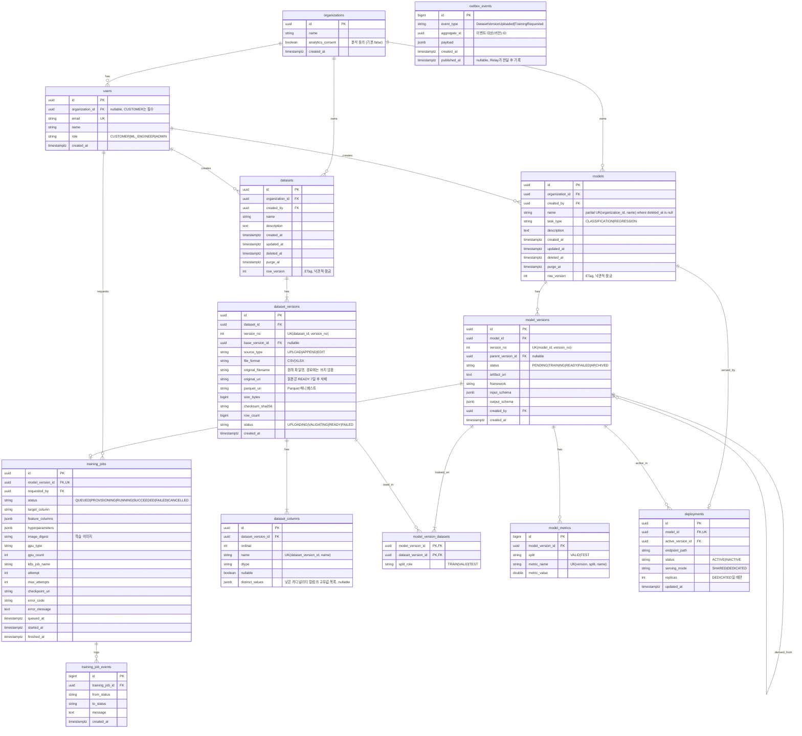

# AutoML 플랫폼 ERD

AutoML 플랫폼 전체 데이터 모델. 이 저장소는 이 중 `organizations`, `users`, `models`, `model_versions`를 구현한다. 스키마의 기준(source of truth)은 Alembic 마이그레이션이며, 이 문서는 설계 의도를 설명한다.

## 설계 원칙
- 고객 데이터(데이터셋, 모델)는 사용자 개인이 아니라 고객 조직(`organizations`)이 소유한다. 같은 조직의 사용자는 데이터를 공유하고, 다른 조직의 데이터는 볼 수 없다 (ADR 0006)
- 파일(데이터 원본, 모델 아티팩트)은 오브젝트 스토리지에 저장하고 DB에는 메타데이터와 URI만 저장
- 데이터와 모델은 "이름표(datasets/models) + 불변 버전(*_versions)" 구조. 수정/추가 시 덮어쓰지 않고 새 버전 생성 → 재현성 확보
- 모델과 데이터셋 삭제는 소프트 삭제(`deleted_at`) + 복원 기한(`purge_at`). 기한이 지나면 즉시 영구 삭제된 것으로 본다
- 모델별로 다른 입출력은 `model_versions.input_schema / output_schema` (JSONB, JSON Schema 형식)으로 관리
- 학습 상태는 `training_jobs.status` + 이력 테이블 `training_job_events`로 추적, 장시간 학습 대비 체크포인트/재시도 컬럼 보유
- 추론 요청/응답 로그는 양이 많아 RDB에 두지 않고 데이터 레이크(Parquet)로 적재 → 서비스 DB와 분석 부하 분리

## 테이블 요약
| 영역 | 테이블 | 역할 |
|---|---|---|
| 조직 | organizations | 고객사(테넌트). 데이터셋과 모델의 소유 단위, 내부 분석 동의 여부 |
| 사용자 | users | 고객/내부 사용자, role로 구분. 고객은 조직 하나에 속함 |
| 데이터 | datasets | 데이터셋 이름표, 소프트 삭제 + 복원 기한, 낙관적 잠금(row_version) |
| 데이터 | dataset_versions | 업로드 파일 1건, 원래 파일명, 원본 URI, Parquet 매니페스트 URI, 크기, 체크섬, 업로드 상태 |
| 데이터 | dataset_columns | 버전별 컬럼명, 타입, 낮은 카디널리티 컬럼의 고유값 목록 |
| 모델 | models | 모델 이름표, 소프트 삭제 + 복원 기한 |
| 모델 | model_versions | 학습 결과물 v1, v2…, 부모 버전, 입출력 스키마, 아티팩트 URI |
| 모델 | model_version_datasets | 버전 ↔ 데이터 버전 N:M (학습 데이터 계보) |
| 모델 | model_metrics | 성능 지표 (행 단위, 버전 간 비교 용이) |
| 학습 | training_jobs | 학습 작업 (버전당 최대 1개, 학습 없이 등록한 버전에는 없음), 상태, 학습 이미지 digest, GPU, K8s Job, 체크포인트, 재시도 |
| 학습 | training_job_events | 학습 상태 변경 이력 |
| 서빙 | deployments | 모델별 엔드포인트, active_version_id 교체로 배포/롤백, 공유 서버 풀/전용 서버 구분 |
| 메시징 | outbox_events | 업무 데이터와 같은 트랜잭션에 기록하는 이벤트, Outbox Relay가 SQS로 전달 |

## 다이어그램

